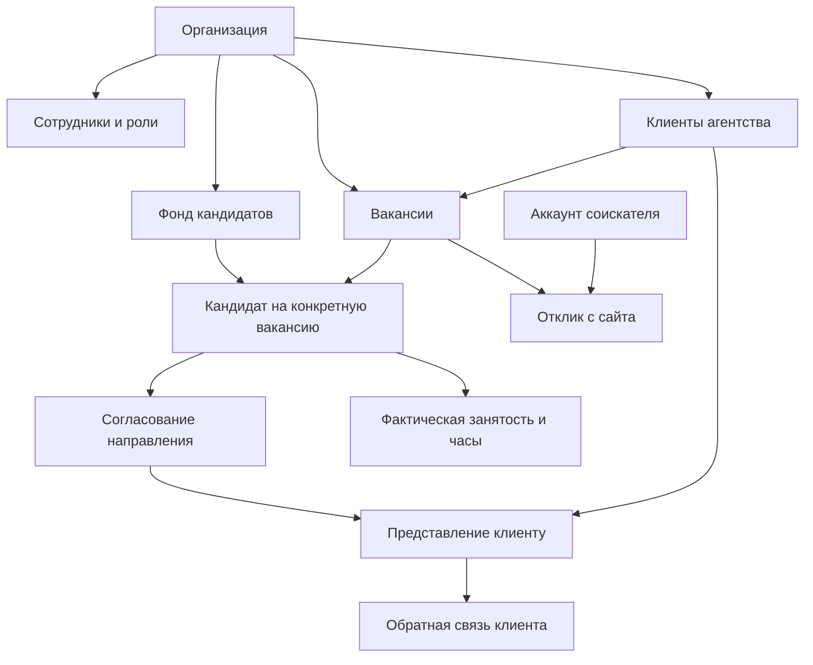

# HeadHunter: устройство продукта и логика проекта

Дата разбора: 4 ноября 2026 года.

Реальный публичный счётчик нанимающих компаний10.11.2026: [компании/источники с видимыми открытыми вакансиями, без QA](hiring-company-count-2026-11-10.ru.md).

Общий публичный фонд кандидатов, последнее уточнение владельца: [импорт + регистрации, уникальность по контактам и исключение QA](candidate-population-count-2026-11-10.ru.md). Заменяет на главной прежний счётчик только регистраций.

Публичный счётчик зарегистрированных кандидатов, решение09.11.2026: [подтверждённые email, исключение QA и границы публичного агрегата](registered-candidate-count-2026-11-09.ru.md).

Горячие вакансии09.11.2026: [облачный анонимный рейтинг по минимуму откликов,8карточек и результаты разбора качества](featured-job-ranking-2026-11-09.ru.md). CV061 остаётся отдельным заблокированным выпуском.

Проверка пяти направлений пилота09.11.2026: [17 scoped API checks, зашифрованная копия и локальный restore, качество вакансий, незакрытые решения](pilot-five-checks-2026-11-09.ru.md). [Кнопка помощи возвращена на публичную страницу и проверена на www](help-access-2026-11-09.ru.md). Это не завершение облачной приёмки CV и не разрешение на пилот.

Обновление бренда 08.11.2026: владелец выбрал сине-фиолетовую монограмму HR и имя hr-ai.tech. [Решение и реализация](brand-logo-2026-11-08.ru.md). Ниже сохранён исторический разбор с прежним названием HeadHunter.

Решение владельца09.11.2026: активные опубликованные вакансии остаются на сайте независимо от возраста проверки; семидневное исчезновение отменяется. [Актуальное правило и границы облачного применения](active-job-lifecycle-2026-11-09.ru.md).

Оптимизация публичной загрузки и возврат логотипа слева09.11.2026: [изменения, измерения и проверки](public-performance-2026-11-09.ru.md).

Следующий этап с измеренным до публикации улучшением TTFB/появления карточек: [статические языковые оболочки, ранний публичный запрос и критерий публикации](server-loading-2026-11-09.ru.md).

Основа: все 15 страниц `project-documentation.pdf` версии 1.0 от 3 ноября 2026 года и выборочная сверка текущего локального кода, SQL-миграций и тестов. Это руководство для знакомства с проектом, а не подтверждение работоспособности облака или полный аудит безопасности. Облако, реальные аккаунты и отправка сообщений при подготовке разбора не проверялись. Числа из PDF — исторические снимки.

## 1. Что это за SaaS

**HeadHunter — платформа управления подбором персонала с публичным сайтом вакансий и совместной работой агентства с работодателем.** Начальный рынок — Израиль; интерфейс рассчитан на иврит с RTL и английский с LTR.

Продукт объединяет несколько контуров:

| Контур | Пользователь | Задача |
|---|---|---|
| Публичный сайт | Соискатель | Найти вакансию, сохранить её, создать профиль, откликнуться, отслеживать процесс |
| Рабочее пространство работодателя | Собственная HR-команда компании | Вести вакансии, общий фонд кандидатов и внутренний подбор |
| Рабочее пространство агентства | Руководители и рекрутеры | Вести свой фонд, клиентов, направления, согласования, интервью и результаты |
| Клиентский портал | Представитель заказчика агентства | Рассмотреть только направленных кандидатов и дать обратную связь |
| Управление платформой | Оператор HeadHunter | Управлять публичным контентом, коммерческими аккаунтами, поддержкой и платформенными показателями |

По классу это сочетание ATS (система ведения подбора), базы кандидатов, клиентского учёта агентства и сайта вакансий. Это аналитическое описание продукта, а не список подключённых внешних сервисов.

Его основная ценность: связать вакансию, человека, работу рекрутера, решение клиента и фактический выход на работу в прослеживаемый процесс с ограниченным доступом и историей действий.

## 2. Кто кому оказывает услугу

Есть три независимых отношения:

1. **HeadHunter → агентство или работодатель:** предоставляет программную систему и, по коммерческой модели, входящие отклики с сайта.
2. **Агентство → работодатель-клиент:** оказывает услугу подбора и получает агентское вознаграждение по собственным условиям.
3. **Работодатель → кандидат:** рассматривает человека и принимает решение о трудоустройстве.

Работодатель может пользоваться HeadHunter без агентства. Агентство может работать с заказчиком, у которого нет полного рабочего пространства HeadHunter: ему достаточно ограниченного портала.

Компания, вакансии которой собраны из открытых источников, не становится от этого клиентом платформы или агентства.

## 3. Главные понятия, которые нельзя смешивать

### Пользователь и кандидат

`auth.users` — учётная запись человека для входа. `candidate_profiles` — его профиль как соискателя.

`candidates` — запись в фонде конкретной организации. Она может появиться из Excel или от рекрутера и существовать без регистрации человека на сайте.

Следовательно, 51 364 карточки в базе не означают 51 364 зарегистрированных пользователя. Один реальный человек может иметь независимые карточки в разных организациях. По просмотренной схеме нет основания предполагать автоматическую синхронизацию всех этих карточек с его личным профилем.

### Организация и клиент агентства

`organizations` — самостоятельное рабочее пространство работодателя (`employer`) или агентства (`agency`). Это основная граница изоляции данных.

`agency_clients` — заказчик внутри учёта агентства. Он не обязан иметь собственное рабочее пространство. Позднее его можно связать с организацией работодателя через согласованный переход, сохранив исходные записи.

### Отклик, направление, согласование и представление

| Понятие | Сущность | Смысл |
|---|---|---|
| Отклик с сайта | `applications` | Зарегистрированный соискатель откликнулся на вакансию |
| Участие кандидата в подборе | `candidate_placements` | Рекрутер связал карточку из фонда с конкретной вакансией |
| Согласование направления | `candidate_submissions` | Можно ли отправить этого кандидата клиенту; кто запросил, одобрил и отправил |
| Клиентское представление | `client_presentations` | Какую именно информацию открыли конкретному клиенту |
| Фактическая работа | `placement_employment` | Когда человек начал и закончил работать |

Название `placement` здесь может вводить в заблуждение: запись создаётся уже на стадии подбора и сама по себе не доказывает трудоустройство.

## 4. Карта сущностей

| Группа | Основные таблицы | Назначение |
|---|---|---|
| Идентификация | `auth.users`, `account_settings`, `candidate_profiles` | Вход, личные настройки, контакты и профиль соискателя |
| Организации | `organizations`, `memberships` | Рабочие пространства, сотрудники, роли, статус и подчинение |
| Разрешения | `member_permissions`, `candidate_access`, `access_requests` | Дополнительные права и индивидуальный доступ к карточке |
| Вакансии | `jobs`, `external_jobs`, `job_sources` | Организационные и собранные внешние вакансии, происхождение данных |
| Публичная активность | `saved_jobs`, `applications`, `application_activity`, `application_messages` | Сохранённые вакансии, отклики, история и сообщения по ним |
| Фонд организации | `candidates`, `candidate_documents` | Карточки людей и прикреплённые документы |
| Профессиональные интересы | `career_roles`, `candidate_interests` | Несколько желаемых должностей с активностью и датой подтверждения |
| Внутренний подбор | `candidate_placements`, `placement_activity`, `candidate_submissions` | Воронка кандидата по вакансии, история и согласование отправки |
| Интервью и задачи | `interviews`, `placement_interviews`, `recruitment_tasks` | Встречи по двум видам подбора и задачи сотрудников |
| Клиенты и сотрудничество | `agency_clients`, `recruitment_partnerships` | Клиентский учёт и записи о партнёрствах |
| Клиентский доступ | `client_portal_members`, `client_presentations`, `client_feedback`, `agency_client_portal_policy` | Представители, опубликованные снимки, отзывы и политика обезличивания |
| Переход в полный аккаунт | `client_organization_links` | Согласованная связь клиента агентства с организацией работодателя |
| Агентский расчёт | `agency_client_fee_terms`, `placement_employment`, `placement_work_periods` | Ставка комиссии, даты работы, часы и расчётные периоды |
| Вознаграждения сотрудников | `reward_policies`, `reward_entries` | Политика и записи выплат; отдельный от оплаты SaaS контур |
| Коммерция платформы | `commercial_accounts`, `commercial_events`, `commercial_trial_notices` | Тариф, ознакомление, денежный остаток, пакет откликов, журнал и напоминания |
| Общение | `candidate_internal_notes`, `candidate_whatsapp_messages`, `organization_whatsapp_connections`, `whatsapp_unmatched_messages` | Внутренние заметки, WhatsApp, подключения и нераспознанные сообщения |
| Контроль | `management_audit`, `merge_audit`, `platform_support_sessions` | Аудит действий, слияния и ограниченные сеансы поддержки |
| Поддержка | `support_tickets`, `support_replies` | Обращения и ответы |

Это карта основных понятий, а не перечисление всех таблиц. Полная последовательность схемы находится в `supabase/migrations/001_*.sql` — `058_*.sql`.

Два пути подбора сходятся по бизнес-смыслу, но в текущей схеме представлены разными таблицами. Их автоматическое объединение нельзя считать готовой функцией.

## 5. Основные пользовательские сценарии

### Соискатель

1. Ищет вакансии по области, должности или словам, региону и городу.
2. Открывает детали, сохраняет или делится ссылкой HeadHunter.
3. Регистрируется, подтверждает email, заполняет профиль и при необходимости загружает CV.
4. Откликается с контактным телефоном и сопроводительным текстом.
5. Видит свои отклики, доступные статусы, сообщения и интервью.

В текущем интерфейсе вход выполняется по email и паролю; телефон служит контактом и не подтверждается SMS. Бизнес-регистрация требует контактный телефон; для отправки отклика телефон также проверяется на сервере. Обязательность контактов при всех остальных действиях требует отдельной продуктовой фиксации.

**Особый случай внешней вакансии:** интерфейс прямо сообщает, что отклик сохраняется для обработки командой платформы и автоматически работодателю не отправляется. Публикация вакансии из открытого источника не доказывает подключённый канал приёма откликов у этой компании.

### Работодатель нанимает себе

1. Создаёт организацию типа `employer` и добавляет HR-сотрудников.
2. Создаёт вакансии, определяя публичность.
3. Работает с общим организационным фондом кандидатов и входящими откликами.
4. Ведёт рассмотрение, интервью, предложение, решение и фактический выход.

Личное владение карточкой рекрутером для работодателя по требованиям не является моделью работы: фонд общий. При этом технические поля автора и владельца могут сохраняться для учёта и истории.

### Агентство подбирает клиенту

1. Создаёт клиента и фиксирует контакты и условия сотрудничества.
2. Заводит вакансию, связанную с клиентом.
3. Ищет в своём фонде, импортирует или создаёт кандидата.
4. Уточняет интерес, квалификацию и готовность; ведёт внутренние заметки и задачи.
5. Связывает человека с вакансией через `candidate_placements`.
6. Запрашивает согласование, если оно требуется для сотрудника.
7. После одобрения публикует представление в портале либо фиксирует ручную отправку.
8. Получает отзыв клиента, организует интервью и ведёт решение по кандидату.
9. Отдельно фиксирует начало работы, завершение и фактические часы для расчёта комиссии.

`record_candidate_sent` фиксирует состоявшуюся ручную отправку; его вызов сам по себе не отправляет письмо.

## 6. Воронка и жизненные циклы

Базовые стадии подбора:

`submitted → reviewing → interview → offer → hired`

Завершение без найма: `rejected`; отзыв участия: `withdrawn` там, где поддерживается соответствующим процессом.

Эта цепочка показывает обычный смысл стадий. Нельзя выводить из неё строгий запрет всех переходов через несколько стадий: в локальном коде есть упрощённые проверки, а фактические ограничения зависят от конкретного серверного пути.

Статусы согласования направления существуют отдельно:

`pending → approved → sent`, либо `pending → rejected`.

Для рекрутера согласование зависит от `approval_required`. В просмотренном SQL при отсутствии такого требования заявка сразу создаётся одобренной. Согласующий должен иметь право согласования и доступ к соответствующему подбору; для командного руководителя также учитывается подчинение автора запроса.

Клиентская обратная связь — ещё один отдельный набор событий: продолжить, отклонить, запросить информацию, запросить или назначить интервью, сообщить о найме, начале или завершении работы, оставить комментарий.

Не следует считать равнозначными: «клиент одобрил», `hired`, «начал работать», «отработал 30 дней», «комиссия рассчитана» и «деньги получены».

## 7. Роли и иерархия

### Платформенный уровень

Администратор платформы обозначается отдельно через `platform_admins`. Это не роль сотрудника агентства и не автоматическое членство во всех организациях.

Он управляет платформенными функциями и может открыть явный сеанс поддержки организации. В миграции 033 такой сеанс имеет срок 15 минут, начинается в режиме чтения и журналируется. Просмотренный серверный путь показывает ограниченный набор карточек, вакансий, направлений и сотрудников. В режиме редактирования предусмотрен отдельный путь изменения вакансии. Это не полноценный вход под любым пользователем.

### Уровень агентства

| Роль | Код | Основная ответственность |
|---|---|---|
| Администратор организации | `org_admin` | Настройки, сотрудники, права, весь фонд и управление организацией |
| Руководитель подбора | `recruitment_manager` | Общая работа подбора, вакансии, команда, согласования и разрешённое слияние |
| Руководитель команды | `team_lead` | Работа своей команды, подчинённые, согласования и отчёты своего контура |
| Рекрутер | `recruitment_coordinator` | Доступные кандидаты, документы, подбор, задачи и интервью |
| Просмотр | `viewer` | Чтение разрешённых данных без полномочий на запись |
| Финансы | `finance` | Разрешённые финансовые разделы без автоматических рекрутинговых полномочий |

### Уровень работодателя

`org_admin → hr_manager → internal_coordinator`.

Дополнительно схема допускает `viewer` и `finance`. Отдельная роль нанимающего руководителя отдела отложена.

В коде сохраняются старые обозначения `owner`, `admin`, `recruiter`. Сервер нормализует их с учётом типа организации. При разработке нужно проверять `org_capability` и конкретную SQL-процедуру, а не ориентироваться только на старое название роли или подпись в интерфейсе.

## 8. Permissions: как определяется доступ

Доступ складывается из нескольких условий:

**Активное членство в нужной организации + полномочие на действие + доступ к конкретной записи + ограничения её состояния.**

Для обычных организационных операций членство должно иметь статус `active`. Статусы сотрудника: `active`, `suspended`, `closed`. Внешний портал и платформенная поддержка используют отдельные модели допуска.

### Матрица базовых полномочий по `org_capability`

«Отдельное право» означает явную запись разрешения; все действия также ограничены доступом к конкретной записи и дополнительными проверками процедуры.

| Действие | Администратор | Руководитель подбора | HR-руководитель | Руководитель команды | Рекрутер |
|---|---|---|---|---|---|
| Управление организацией | Да | Нет | Нет | Нет | Нет |
| Управление командой | Да | Да, с ограничениями на роли | Да, с ограничениями на роли | Настройка своих подчинённых | Нет |
| Управление вакансиями | Да | Да | Да | Нет | Нет |
| Доступ ко всему фонду | Да | Да | Да | Нет, свой командный контур и общие записи | Доступные записи |
| Изменение доступных кандидатов | Да | Да | Да | Да | Да |
| Выполнение слияния | Да | Да | Нет | Нет, может предложить | Нет |
| Согласование направлений | Да | Да | Да | В своём контуре | Нет |
| Скачивание CV | Да | Отдельное право | Отдельное право | Отдельное право | Отдельное право |
| Экспорт кандидатов | Да | Отдельное право | Отдельное право | Отдельное право | Отдельное право |
| Просмотр вознаграждений | Да | Да | Только с дополнительным правом | Только с дополнительным правом | Только с дополнительным правом |
| Управление вознаграждениями | Да | Отдельное право | Отдельное право | Отдельное право | Отдельное право |
| Отчёты | Да | Да | Да | Да, в разрешённом контуре | Нет базового полномочия |

Матрица не означает, что любой экран обязан использовать только эти полномочия. Например, коммерческий аккаунт SaaS читают администратор организации, `finance` и администратор платформы. В пилотном расчёте комиссии миграция 046 требует `organization.manage`, то есть это ещё более узкий доступ, чем общий модуль вознаграждений.

### Кто видит карточку

Для несоединённой с другой карточки внутри своей организации сервер допускает чтение, если выполняется хотя бы одно условие:

- пользователь — владелец карточки;
- карточка общая (`shared`);
- у сотрудника есть `candidates.all`;
- есть `candidates.team` и владелец подчиняется сотруднику;
- предоставлен индивидуальный `candidate_access`.

Общая карточка означает общую **внутри организации**. Это не публикация персональных данных на сайте и не открытие другим агентствам.

При постоянном закрытии сотрудника его личные карточки переводятся в общий фонд; при временной блокировке этого не происходит. Авторство и история должны сохраняться.

### Просмотр, скачивание и экспорт

Продукт различает эти действия. RPC скачивания проверяет `cv.download`, экспорт — отдельное разрешение и область видимости.

Но текущий просмотр PDF выдаёт браузеру подписанную ссылку на файл. Поэтому запрет отдельной кнопки скачивания нельзя трактовать как техническую невозможность сохранить уже доступное для просмотра содержимое. Если продукту требуется более сильная защита документов, модель доставки файлов нуждается в отдельном решении и проверке.

Защита должна действовать в PostgreSQL RLS, Storage и серверных процедурах. Скрытая кнопка или проверка React-компонента не заменяет серверное разрешение. Процедуры `security definer` требуют особого внимания: они выполняют привилегированные операции и должны сами проверять полномочия.

## 9. Фонд кандидатов и импорт

Карточка не требует наличия CV или зарегистрированного аккаунта. По требованиям она содержит контакты, местоположение, профессиональные интересы, навыки, опыт, языки, доступность, зарплатные ожидания, документы и историю работы с человеком.

Импортированный Excel примерно на 52 тысячи человек должен попадать в общий фонд конкретного агентства. По снимку в PDF сохранено 51 364 кандидата; это не доказательство текущего количества или того, что каждый человек сейчас ищет работу.

Правила качества:

- отсутствие email или CV не должно автоматически выбрасывать строку;
- телефон нормализуется, а израильский префикс корректно отображается;
- числовой код вроде `(1004)` не считается названием профессии;
- исходный статус нельзя без проверки превращать в стадию подбора;
- дата добавления, исходная дата изменения и системное обновление различаются;
- демографические и транспортные поля сохраняются согласно принятым требованиям;
- нужны предпросмотр, маппинг, партии, возобновление и ошибки по строкам.

У одного кандидата несколько профессиональных интересов. Их активность должна обновляться отдельно: наличие старой профессии в Excel не доказывает актуальный интерес к ней.

### Дубликаты

Внутри организации используются валидные телефон и email; одно имя не является достаточным основанием. При закрытой существующей карточке нужен запрос доступа, а не обход изоляции новой записью.

Между организациями независимые записи допустимы. Для платформенной статистики уникальность по телефону, затем email — правило подсчёта; оно не разрешает глобальное слияние фондов.

Слияние требует сравнения данных, сохранения документов, интересов, направлений и истории, а также контролируемого восстановления. Предложение слияния и его выполнение — разные права.

**Открытый вопрос:** в PDF одновременно есть модель личного владельца карточки и более позднее предложение о приоритете первого направления. В коде `owner_id`, `handler_id` и автор действия уже участвуют в разных проверках. До утверждения нового правила нельзя произвольно считать их одним «ответственным» или менять владельца при каждом направлении.

## 10. Клиентский портал и сотрудничество

Портал — управляемое окно в результат работы агентства. Он не открывает клиенту весь фонд.

Представитель клиента видит активные представления, выбранные документы, общие статусы и доступную обратную связь. У него нет автоматического доступа к внутренним заметкам, WhatsApp агентства, вознаграждениям, другим клиентам и редактированию исходной карточки.

Представление хранит `snapshot`: отдельный снимок разрешённых данных. Изменение исходной карточки не следует считать автоматическим обновлением всех ранее отправленных снимков.

### Обезличивание

Для клиента можно включить анонимный режим. В текущей миграции 050:

- старые активные неанонимные представления отзываются;
- исходный CV прикреплять запрещено;
- требуется подтверждение ручной проверки описания;
- текст проверяется на некоторые идентификаторы;
- наружу выдаётся сокращённый снимок без исходных контактов;
- версия приватности отделяет видимую внешнему пользователю историю отзывов.

Это защита публикации, а не доказательство идеального автоматического удаления любых персональных признаков из произвольного текста. Уже просмотренные сведения нельзя «забрать обратно» у человека.

### Полный аккаунт работодателя

Представитель с подтверждённым email и активным доступом к порталу может запросить связь клиента с организацией работодателя, где он администратор, либо создать её разрешённым путём. Затем требуется отдельное одобрение администратора агентства. Сохраняются клиент, представления, отзывы и условия; весь фонд не копируется, все сотрудники работодателя доступ не получают.

**Обнаруженное расхождение:** PDF описывает прекращение сотрудничества с отзывом соответствующего внешнего доступа. Но `end_portal_organization_link` в миграции 057 прекращает связь организаций и явно сохраняет индивидуальное членство в портале. Отзыв представлений, отключение пользователя портала и завершение связи организаций — разные операции. Их общий жизненный цикл нужно согласовать и проверить отдельно.

Три сценария сотрудничества из PDF — полные аккаунты обеих сторон, внешний клиент агентства и внешний поставщик работодателя — не стоит считать одинаково завершёнными. В просмотренном коде наиболее явно представлен клиентский портал агентства. Таблица `recruitment_partnerships` хранит записи о сотрудничестве, но сама по себе не создаёт сквозного доступа к чужим данным или полноценный двусторонний обмен.

## 11. Денежная модель

### Доход HeadHunter

Планируются два разных предмета продажи:

1. Подписка на рабочую систему подбора.
2. Предоплаченный пакет входящих откликов/CV с публичного сайта.

В `commercial_accounts` предусмотрены планы `trial`, `solo`, `team`, `organization`. Это значения модели, а не доказательство утверждённого прайса и работающей покупки.

Денежный остаток (`money_agorot`, в агоротах) и количество доступных откликов (`application_balance`) учитываются отдельно. Импорт собственной базы и обновление старой карточки не являются покупкой входящего отклика.

По принятому решению новый входящий отклик уже известного человека может быть платным. Но правила повторного списания, временной дедупликации, цены и момент потребления пакета ещё требуется утвердить.

В коде есть коммерческий центр, продление ознакомления днями/неделями/календарными месяцами, выдача откликов и журнал событий с ключом идемпотентности. Автопродление в текущей схеме явно запрещено (`check(not auto_renew)`).

По PDF не активны: платёжный процессор, покупки, автоматический расход пакета за отклик и фоновые напоминания вне посещения сайта. Наличие типов `payment_verified` и `application_debit` в таблице не доказывает готовый процесс оплаты или списания. Блокировку при нулевом пакете ещё нужно проверить до коммерческого запуска.

### Доход агентства

Агентская комиссия платится клиентом агентству и не является выручкой HeadHunter.

Для пилота с Хаци Хинам согласовано:

`комиссия за месяц = базовая почасовая ставка × фактические часы × 22%`

Например, при ставке 40 ₪ и 160 часах комиссия месяца составляет 1 408 ₪. Это иллюстрация формулы, а не реальные данные кандидата или тариф платформы.

Расчёт возможен максимум за три месяца. Три месяца по 22% не означают умножение всех часов на 66%. Минимальный срок занятости — 30 дней; далее неполный месяц учитывается по фактической работе. Отдельная гарантия для этого пилота не согласована.

В локальном расчёте периоды привязаны к дате начала работы календарными месяцами. Учитываются подтверждение часов, длительность работы, завершённость периода и допустимое количество часов. Сумма называется оценочной (`estimated_amount`), а право на неё — `eligible`. PDF всё ещё требует явно утвердить границы месяцев и порядок подтверждения табеля. Это пример того, где технический выбор уже существует, а договорное правило ещё нужно закрепить.

### Вознаграждения сотрудников

`reward_entries` и `reward_policies` представляют ещё один контур. Его нельзя смешивать ни с подпиской HeadHunter, ни с агентским счётом клиенту. Наличие отметки `paid` в учётной записи не означает интеграцию с банком или автоматическую выплату.

## 12. Сообщения, WhatsApp и помощь

Внутренняя заметка и сообщение кандидату — разные данные и разные действия. Клиент и кандидат не должны получать внутренние заметки. Сохранение черновика не отправляет сообщение.

Миграция 058 содержит модель WhatsApp организации, черновики, статусы, входящие сообщения и очередь неоднозначных номеров. Подготовлены серверные маршруты отправки и webhook, проверка подписи, защита от повторной обработки и статусы доставки.

Путь отправки проверяет пользователя и право на кандидата до обращения к привилегированным серверным учётным данным. Вне 24-часового окна текстовая отправка блокируется до реализации шаблонов. Неопределённый результат не должен автоматически повторяться. Номер, не сопоставленный однозначно, не связывается с человеком по имени.

По состоянию документа WhatsApp **не подключён**, реальные сообщения не отправлялись; Meta блокирует бизнес. Подготовленный серверный код не снимает эту внешнюю блокировку. Просмотр вложений ещё не подключён.

Помощь — справочный поиск, FAQ и переходы с учётом роли. Это не активный AI-ассистент. Обращения поддержки существуют отдельно.

## 13. Публичные вакансии и соответствие

Организационные вакансии и внешние публикации имеют разное происхождение. Для внешних данных важны внутреннее хранение источника, проверка и редакционная обработка.

По требованиям нельзя придумывать зарплату, условия и квалификацию, объявлять компанию клиентом без оснований или публично подменять ссылку HeadHunter внешней ссылкой работодателя.

Текущий `my_job_skill_matches` использует словарь навыков и регулярные выражения. Он рассчитывает долю распознанных требуемых навыков, найденных в профиле. Это не AI и не вероятность найма; отсутствие данных не должно превращаться в вымышленную оценку.

Нужно различать три числа: зарегистрированные аккаунты соискателей, карточки в фондах организаций и уникальные реальные люди. Отчёт по профессиям также отличается от количества открытых вакансий.

## 14. Техническое устройство и карта кода

Стек по `package.json`: Next.js 16.4.3, React 19.2.0, TypeScript, Supabase JavaScript SDK. Supabase предоставляет PostgreSQL, Auth и приватное Storage.

Значительная часть бизнес-логики расположена в SQL: процедуры, RLS, ограничения и триггеры. Интерфейс часто обращается к Supabase непосредственно от имени пользователя. Поэтому проверять только файлы `app/api` недостаточно для понимания серверного поведения.

| Где читать | Что искать |
|---|---|
| `app/home.tsx` | Общая навигация, аккаунт, публичные вакансии и отклики |
| `app/workspace.tsx`, `app/organization-*.tsx` | Рабочее пространство организации |
| `app/candidate-*.tsx` | Карточка, документы, интересы, слияние и переписка |
| `app/manual-pipeline.tsx`, `app/submission-approval.tsx` | Внутренний подбор и согласование |
| `app/agency-clients.tsx`, `app/client-portal/` | Клиенты и внешний портал |
| `app/placement-pilot.tsx` | Выход на работу, часы и пилотный расчёт |
| `app/commercial-workspace.tsx` | Коммерческий аккаунт платформы |
| `app/platform-support-workspace.tsx` | Явный сеанс поддержки организации |
| `app/api/whatsapp/` | Серверные маршруты интеграции WhatsApp |
| `lib/workspace-permissions.ts` | Загрузка полномочий и отображение ролей; не единственный источник прав |
| `supabase/migrations/016_*`, `017_*` | Иерархия, базовые полномочия и область рекрутингового доступа |
| `supabase/migrations/019_*`, `024_*`, `036_*` | Слияние, восстановление и связанные данные |
| `supabase/migrations/023_*` | Согласование направления |
| `supabase/migrations/046_*` — `052_*` | Клиенты, портал, обезличивание и пилот |
| `supabase/migrations/053_*`, `056_*`, `057_*`, `058_*` | Коммерция, контакты, переход портала и переписка |
| `tests/` | Проверки предметных правил и SQL-сценариев |

Нужно читать миграции последовательно: поздние файлы переопределяют ранние функции. Одна начальная миграция не описывает актуальную систему.

Тестовый помощник `tests/support/database.mjs` разворачивает SQL в PGlite с упрощёнными `auth` и `storage`. Такие проверки полезны для бизнес-правил и доступа, но не заменяют реальный Supabase JWT/PostgREST, доставку писем, Storage и браузерный клиентский цикл. В рамках этого разбора тесты повторно не запускались.

Перед изменениями Next.js нужно читать локальные руководства в `node_modules/next/dist/docs/`, как требует `AGENTS.md`.

## 15. Что готово, что подтверждено только исторически

| Область | Что можно сказать обоснованно |
|---|---|
| Каркас подбора, организации и роли | Есть локальный код, SQL и тестовые сценарии |
| Импортированный фонд | PDF сообщает о 51 364 карточках в конкретной проверенной копии |
| Клиентский портал и переход в организацию | Есть схема и серверные пути; полный реальный клиентский цикл ещё требовал подтверждения |
| Коммерческие остатки и льготы | Есть модель, журнал и интерфейс; полноценный биллинг не активен по PDF |
| WhatsApp | Подготовлен код; внешнее подключение заблокировано по PDF |
| AI | Провайдер не подключён; активный AI исключён из текущего пилота |
| Почта и календарь | Бизнес-рассылки и календарные приглашения не подключены; подтверждение email в Auth — отдельный механизм |
| Актуальная работа облака | При подготовке этого руководства не проверялась |

Исторический пилот: агентство «Тасука Това» подбирает для Хаци Хинам. На проверку 3 ноября 2026 года указаны 12 открытых вакансий клиента, отсутствие зарегистрированного представителя и 0 общих представлений. Эти показатели нельзя переносить на сегодняшний день без повторной проверки.

PDF описывает архив с 58 миграциями, 78 таблицами, 51 364 кандидатами и 267 120 строками аудита. Это не атомарный `pg_dump`, не полный экспорт настроек Supabase, а восстановление именно этой копии ещё не выполнялось. Наличие архива и сверенных количеств не доказывает восстановимость системы. PDF также указывает на персональные и аутентификационные данные в архиве: его содержимое не предназначено для публичного репозитория.

Локальный README существенно старше описанной в PDF модели: он упоминает только первые две миграции и некоторые уже расширенные сценарии как отложенные. Использовать его как актуальное техническое задание нельзя. Windows-пути из PDF описывают прежнюю среду; текущая рабочая копия находится в `/Users/reuvenyanturin/Projects/hr-ai.tech`.

## 16. Какие решения ещё нужны

1. **Владение и приоритет направления.** Что даёт первое направление: право вести процесс, коммерческий приоритет или владение карточкой? На какой срок и в каких пределах?
2. **Коммерческий договор платформы.** Прайс, состав подписки, пакеты, момент списания, повторы, возвраты, нулевой остаток и истечение trial.
3. **Конфликты агентств.** Один человек направлен одному работодателю несколькими поставщиками: кто решает право на комиссию и по каким доказательствам?
4. **Клиентский доступ.** Какие действия прекращают связь, членство в портале и доступ к прежним представлениям; что сохраняется только в истории?
5. **Даты и расчёты.** Разделение принятия предложения, выхода и завершения; границы месяцев, подтверждение часов и корректировки комиссии.
6. **Контактная политика.** Где обязательны email и телефон, как подтверждаются и когда разрешена реальная отправка сообщений.
7. **Рабочие данные и эксплуатация.** Оператор, поддержка, сроки хранения, удаление, повторяемые копии и проверка восстановления.

Эти вопросы влияют на сущности, ограничения и серверные процедуры. Их нельзя закрыть одной доработкой интерфейса.

## 17. Как продолжать развитие

Сначала пройти один реальный сквозной цикл в изолированной среде: вакансия клиента → кандидат → согласование → представление → вход представителя → отзыв → интервью → решение → фактический выход → часы → проверка расчёта.

Параллельно проверить отрицательные сценарии: чужая организация, закрытая карточка другого рекрутера, неподчинённый сотрудник, запрет экспорта, попытка слияния без прав, внутренние заметки из портала, старое неанонимное представление и прекращение доступа. Для документов отдельно определить реалистичную гарантию «просмотр без скачивания».

Затем восстановить актуальную копию в отдельном проекте и документировать воспроизводимое развёртывание. После фиксации бизнес-правил можно завершать биллинг и WhatsApp, а далее расширять поиск, отчёты, очереди, статусы, опросники и шаблоны.

Marketplace, сложный BI, мобильное приложение, роль руководителя нанимающего отдела, Civi/внешние ATS/CRM и сложная автоматизация не входят в подтверждённый текущий пилот.

## 18. Источники и границы выводов

- `project-documentation.pdf`: стр. 3 — продукт и границы; 5 — публичный поиск; 6 — роли; 7–8 — фонд, импорт и дубликаты; 9 — сотрудничество; 10 — пилот; 11 — коммерция; 12–13 — переписка и Meta; 14–15 — архитектура, копии и развитие.
- Роли и область данных: миграции 016, 017, 022, 023, 024.
- Платформенная поддержка: миграция 033.
- Профессиональные интересы и правила соответствия: миграции 034 и 028.
- Клиентский цикл и расчёты: миграции 046–052; переход организации: 057.
- Коммерция: миграция 053; контакты: 056; WhatsApp: 058 и `app/api/whatsapp/`.
- Доставка PDF в браузер: `app/candidate-documents.tsx`; внешний отклик и формы входа: `app/home.tsx`.
- Модель SQL-тестов: `tests/support/database.mjs`; сценарии анонимности: `tests/client-sharing-policy.test.mjs`.

Фраза «есть в коде» означает наличие реализации в локальной копии. «По PDF подтверждено» означает сохранённый результат прошлой проверки. Ни одна из этих формулировок не означает, что актуальное облако полностью проверено и готово к коммерческой эксплуатации.
